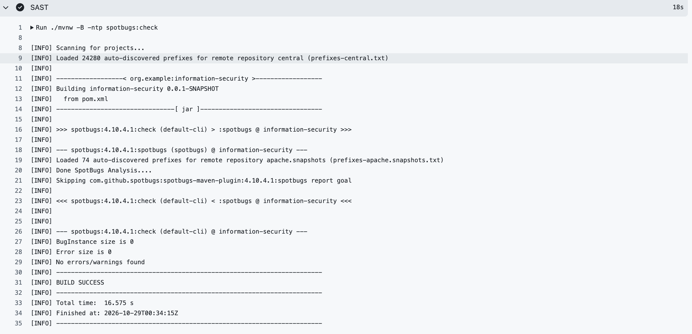
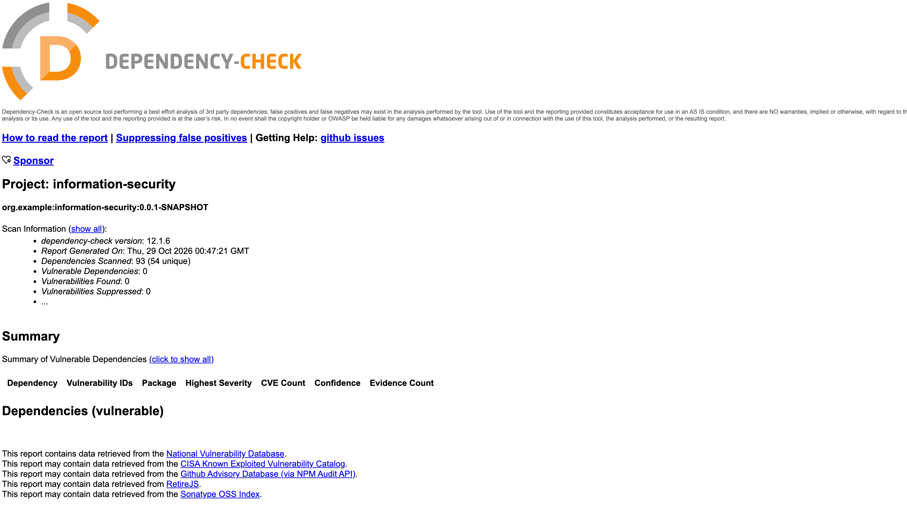

# Информационная безопасность
Лабораторная работа #1

REST API с регистрацией, входом и получением списка пользователей. Список пользователей доступен только после аутентификации по JWT.

## Стек

* Java 17, Spring Boot
* Spring Security, JWT
* Hibernate (Spring Data JPA)
* PostgreSQL
* Maven, Docker

## Описание API

`POST /auth/register`: регистрация пользователя (принимает логин и пароль).

```json
{
    "username": "danila",
    "password": "Labolatorn1"
}
```

`POST /auth/login`: аутентификация пользователя (принимает логин и пароль).

```json
{
    "username": "danila",
    "password": "Labolatorn1"
}
```

Оба метода возвращают токен:

```json
{
    "token": "eyJhbGciOiJIUzI1NiJ9..."
}
```

`GET /api/data`: получение списка пользователей. Доступ только у аутентифицированных пользователей.

```json
[
  {
    "id": 1,
    "userName": "danila"
  },
  {
    "id": 2,
    "userName": "ivan"
  }
]
```

## Описание реализованных мер защиты

* **SQLi.** Запросы к БД строят Spring Data JPA и Hibernate. Ввод передаётся как параметр и не склеивается в SQL.

```java
public interface UserRepository extends JpaRepository<User, Long> {
    Optional<User> findByName(String username);
}
```

* **XSS.** Пользовательские данные экранируются через `HtmlUtils.htmlEscape()` перед отправкой в ответе.

```java
public List<UserResponceDto> getAll() {
  List<UserResponceDto> result = new ArrayList<>();
  for (User user : userRepository.findAll()) {
    result.add(new UserResponceDto(user.getId(), HtmlUtils.htmlEscape(user.getUsername())));
  }
  return result;
}
```

* **Хранение паролей.** При регистрации пароль хешируется BCrypt, в БД сохраняется только хеш.
  Настройка: [`SecurityConfig`](src/main/java/org/example/information_security/security/SecurityConfig.java#L42-L45),
  хеширование: [`AuthService`](src/main/java/org/example/information_security/service/AuthService.java#L40).

* **Аутентификация.** При входе пароль сверяется с BCrypt-хешем, затем выдаётся JWT на 20 минут, подписанный
  HS256 ключом `JWT_SECRET`. Реализация: [`AuthService`](src/main/java/org/example/information_security/service/AuthService.java),
  [`JwtService`](src/main/java/org/example/information_security/security/jwt/JwtService.java).

* **Проверка токена.** Токен передаётся в заголовке `Authorization: Bearer <token>`, фильтр проверяет его подпись
  и срок действия. Все эндпоинты, кроме `/auth/**`, закрыты. Реализация: [`JwtFilter`](src/main/java/org/example/information_security/security/jwt/JwtFilter.java),
  [`SecurityConfig`](src/main/java/org/example/information_security/security/SecurityConfig.java).

##  Скриншоты отчетов SAST/SCA из раздела "Actions" / "CI/CD" репозитория.

SAST:



SCA:




